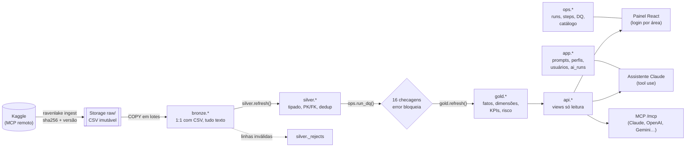
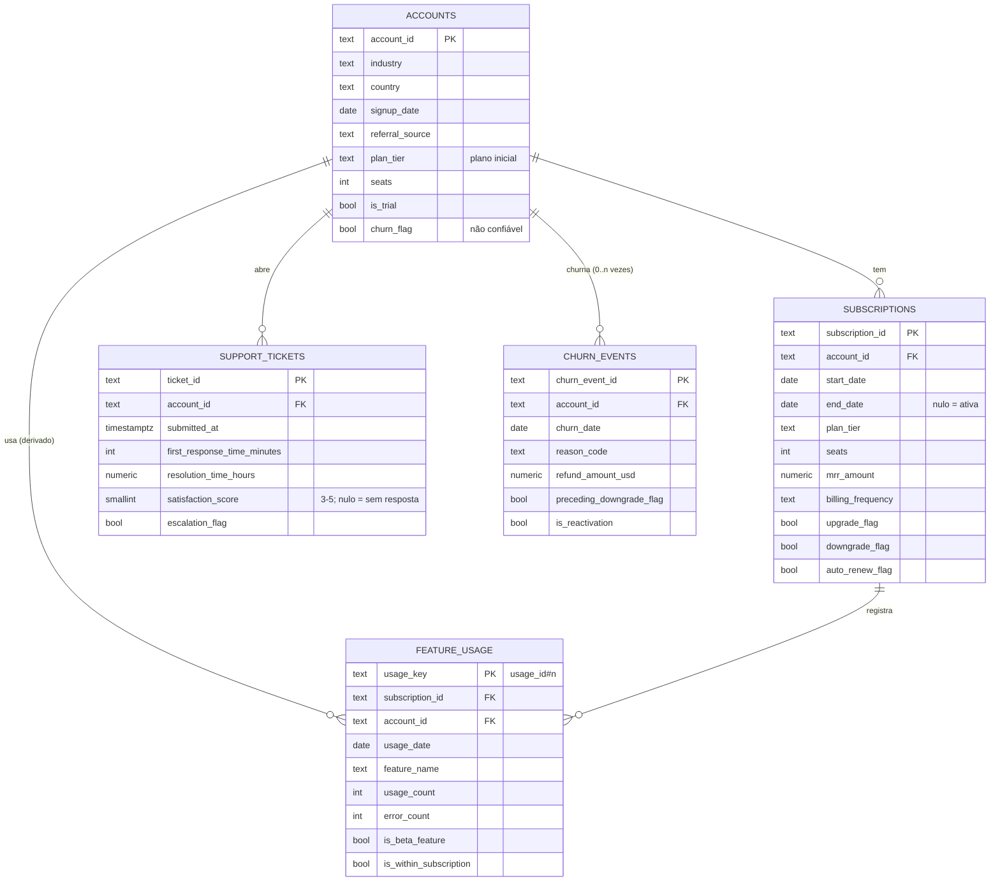
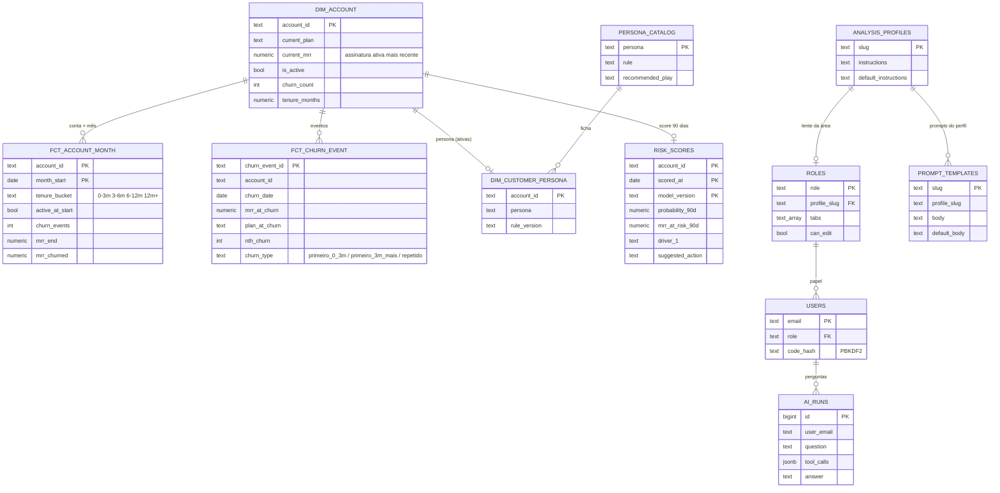
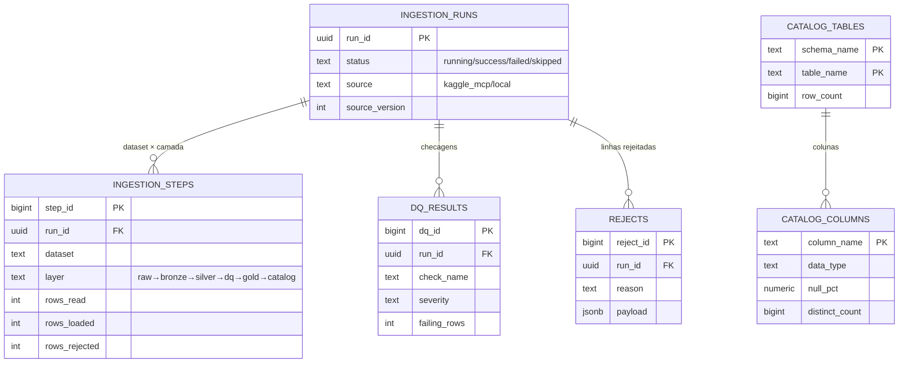

# Modelo de dados — como elaboramos e resolvemos o data lake

Projeto Supabase **G4-Analysys**, Postgres 17, com o bucket `raw` no Storage. Tudo está versionado em [`supabase/migrations/`](../supabase/migrations/). O dicionário completo, gerado do catálogo, está em [`dicionario-de-dados.md`](dicionario-de-dados.md).

## 1. Arquitetura (medalhão)



| Camada | Papel | Regra principal |
|---|---|---|
| **raw** (Storage) | Prova original | Arquivo nomeado pelo sha256 e nunca editado; reprocessar = reler daqui |
| **bronze** | Cópia fiel | Todas as colunas em texto, mais `_run_id`, `_file_sha256`, `_row_number` e `_row_hash`. PK `(arquivo, linha)` torna a carga idempotente |
| **silver** | Verdade tipada | Conversões seguras (`try_date`, `try_int`…); o que falha vai para `_rejects` com o motivo; PK e FK declaradas |
| **gold** | Regras de negócio | Fatos e dimensões materializados; KPIs com as fórmulas do dicionário da skill de negócio |
| **api** | Interface | Único schema lido pelo painel, assistente e MCP; SQL livre só via `run_readonly_query` |
| **ops** / **app** | Operação e aplicação | Execuções, qualidade, catálogo; prompts, perfis, papéis, usuários, auditoria da IA |

## 2. DER — silver (origem: 5 CSVs do Kaggle)



## 3. DER — gold, api e app



As views de KPI (`gold.kpi_*`) agregam esses fatos: hazard por tempo de casa, coortes, segmentos, concentração, tipo de churn, reativação, suporte, churn silencioso, uso e features. Cada uma é exposta como `api.<nome>`.

## 4. ops — operação e observabilidade



## 5. Problemas encontrados e como resolvemos

| Problema nos dados | Evidência | Solução no modelo |
|---|---|---|
| Três definições de churn discordam | 277 contas com evento e `churn_flag` falsa; 35 com a flag sem evento; só 6 de 600 churns coincidem com o fim de uma assinatura | `churn_events` é a fonte de verdade (decidido com o Tiago); as flags viram checagem de qualidade |
| Contas com várias assinaturas abertas ao mesmo tempo | Todas as 500 contas têm 2 ou mais; somando tudo daria mediana de 225 licenças por conta | **MRR vigente = assinatura ativa mais recente** (`gold.subscription_at`), com o mesmo desempate em SQL e em Python |
| Uso fora do tempo | 78% fora do período da assinatura; 53% antes do cadastro | Coluna `is_within_subscription`; a análise usa conta + data do uso; registrado como achado |
| `usage_id` repetido | 21 ids em eventos **diferentes** | Mantidos todos, com `usage_key = usage_id#n` e `has_id_collision` |
| CSAT truncado | Só notas 3–5; 41% nulos | Checagem `csat_escala_incompleta`; nulo = "não respondeu" (`kpi_support_health`) |
| Churn e volta | 87% dos churns seguidos de nova assinatura, mediana de 16 dias | Estado "churnada" = churn sem assinatura posterior (`gold.is_churned_on`); KPIs de receita com ressalva (H9) |
| Funções lentas em views | Funções SQL com `search_path` fixo não são incorporadas na consulta → timeout | `dim_account` e `dim_customer_persona` materializadas; data de referência calculada uma vez |
| Recarga do mesmo arquivo | Reexecução do pipeline | PK `(sha256, linha)` no bronze, mais o salto por versão e hash (run `skipped`) |
| Segurança | Painel e IA lendo o banco | Schemas internos revogados de `anon`/`authenticated`; RLS ligado; leitura só via `api.*`; SQL da IA com validação e transação read-only |

## 6. Como regenerar

```bash
uv run python scripts/apply_sql.py supabase/migrations/<arquivo>.sql   # migrations, em ordem
cd packages/ravenlake && uv run ravenlake ingest                       # carga + DQ + gold + catálogo
uv run python scripts/gen_data_dictionary.py                           # atualiza o dicionário
```
