# Linha do tempo — como resolvemos o desafio em 23/10/2026

Horários reais, tirados do `git log` da branch `submission/tiago-canatelli`. O primeiro commit saiu às 08:35, depois de ~1h de leitura e planejamento a partir das 07:35. Total: **07:35 → 13:00, ~5h25**, com Tiago e Claude Code (Claude Opus 5.5).

```mermaid
gantt
    title Challenge 001 — 23/10/2026
    dateFormat HH:mm
    axisFormat %H:%M
    section Planejar
    Clonar, ler o challenge e planejar        :done, p1, 07:35, 08:35
    Fonte real (Kaggle MCP) e skills por papel :done, p2, 08:35, 09:20
    section Lake
    Migrations, pipeline e qualidade          :done, l1, 09:30, 10:18
    Primeira ingestão real (33.100 linhas)    :done, l2, 10:18, 10:43
    section Diagnóstico
    Hipóteses H0–H8 e causa raiz              :done, d1, 10:43, 10:59
    Camada gold, personas e score de risco    :done, d2, 10:59, 11:14
    section Produto
    API, assistente Claude e MCP              :done, a1, 11:25, 11:33
    Painel React                              :done, a2, 11:33, 11:40
    Usuários por área e admin                 :done, a3, 12:30, 12:34
    section Entrega
    Deploy Render, relatório e README         :done, e1, 12:34, 12:44
    CI/CD testado e documentação do lake      :done, e2, 12:44, 13:00
```

| Hora | Passo | Decisão ou aprendizado | Commit |
|---|---|---|---|
| 07:35 | Clonar o repositório e ler o challenge, o guia e o template | O problema é um **paradoxo** (churn ↑ × "satisfação ok" × "uso cresceu"): planejar antes de executar | — |
| 08:35 | Plano de projeto, plano técnico e 4 skills | Separar negócio, dados e engenharia | `07f23bc` |
| 08:39 | Ler o README original do dataset | A skill tinha colunas **supostas**; troquei pelo schema real (1º erro da IA) | `3c3d654` |
| 08:46 | Baixar os dados pelo **MCP do Kaggle** (sem login) | Sincronização por versão + sha256 | `03378b5` |
| 08:57 | Skill de React/UX, multi-LLM, MCP aberto, RAG | O pedido cresceu; os itens novos foram para o topo da ordem de cortes | `3701de5` |
| 08:59 | Conferir as regras nos CSVs | **`churn_events` = fonte de verdade** (as 3 definições discordam); feedback só tem 4 textos, então o RAG sobre ele foi descartado | `9ecaebe` |
| 09:08 | 8 perfis por área, análise 360, personas, 3 camadas de painel | Persona analista ≠ persona de cliente | `f4557e8` |
| 09:18 | Ambiente único no Supabase SaaS | Sem Docker; testes com rollback | `d0defc4` |
| 09:20 | Process log reforçado | Prompts-chave, timeline, avaliações | `279865e` |
| 10:17 | 5 migrations + pipeline `ravenlake` | Lógica no Postgres; teste de fumaça com rollback; o SDK do MCP 2.3 mudou a API | `f1bb35c` |
| 10:18 | `git add -f` levou 4.306 arquivos de `.venv` para o commit | Refeito com amend + `scripts/stage.sh` | `05204bf` |
| 10:43 | **Primeira ingestão real** | 33.100 linhas, 0 rejeitadas, totais = CSV, segunda execução `skipped` | `248c396` |
| 10:59 | **Diagnóstico** H0–H8 | Contas novas falham nos primeiros 90 dias (46,5 × 8,3); coorte 2024 com OR 3,3; CSAT cego; uso plano. Artefato do "plano atual" descartado | `dde85ec` |
| 11:14 | **Gold:** fatos, 13 KPIs, personas, risco em SQL | GRR com dupla contagem corrigido; views materializadas por desempenho; H9 (sai e volta) | `8b50106` |
| 11:23 | Horários do process log estavam inventados | Reescritos com os commits | `0218481` |
| 11:33 | API + assistente Claude + MCP | Teste real: 24 s, 2 tools, números corretos | `37af94a` |
| 11:37 | Painel React (4 abas) | Validado no navegador com dados reais | `d6e9731` |
| 11:40 | Blueprint e script de deploy | O host direto do Supabase é IPv6 → pooler; senha com `#` → encoding | `a434360` |
| 12:34 | **Usuários por área + admin** | Visão geral para todos; abas e lente da IA por papel; código com hash PBKDF2 | `51a3fbe` |
| 12:36 | **Deploy no Render**, relatório do CEO, README | Impactos recalculados no banco (estavam estimados) | `fa033ff` |
| 12:44 | MCP testado em produção + guia para outras IAs | 5 tools, 18 prompts, 401 sem token | `9b38cc2` |
| 12:47–12:55 | **CI/CD pelo git** | Filtro por `paths` não funcionou; `ignoredPaths` funcionou: docs não redeploya, API redeploya (`/health` mostra o commit) | `85ccf9c`, `83502de` |
| 12:59 | DER, dicionário de dados e esta timeline | Dicionário gerado do catálogo (41 tabelas, 462 colunas); Mermaid validado | — |

## O que ficou de fora (cortes deliberados)

- RAG com busca híbrida;
- provedores OpenAI e Gemini, com avaliação comparativa;
- análise 360 com várias lentes ao mesmo tempo;
- painéis dedicados por área e por persona;
- resposta em streaming;
- cron de ingestão no Render.

Ordem de cortes definida no [plano de projeto](01-plano-projeto.md): **a infraestrutura encolheu, o diagnóstico não**.
